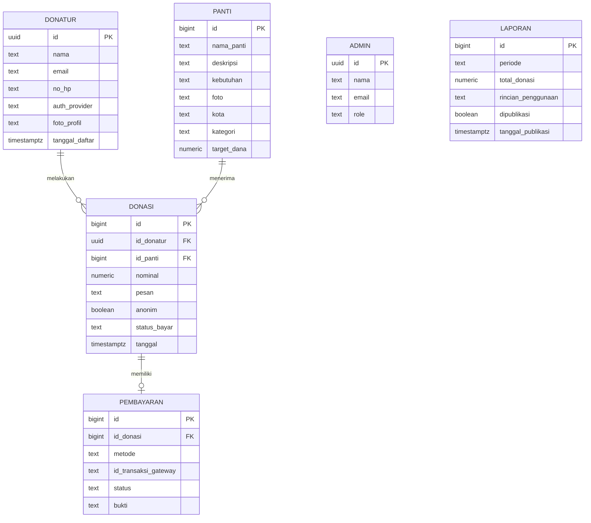
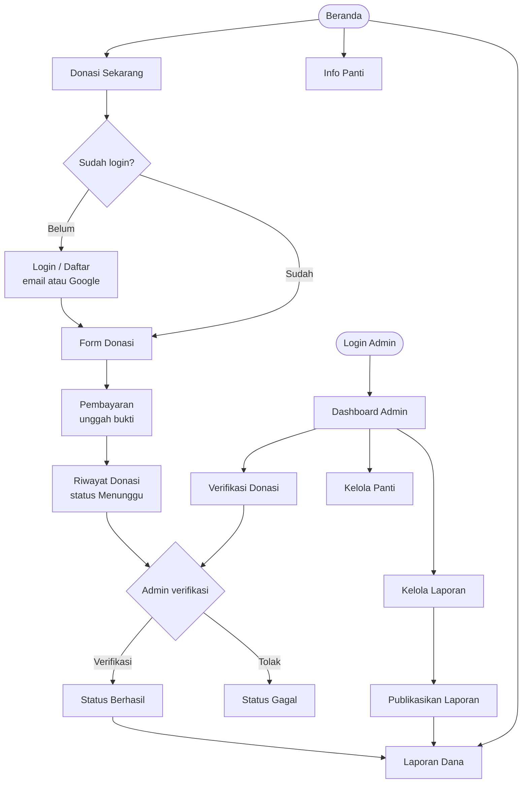

# Ringkasan Perancangan SIDOTI (Sistem Donasi Panti Asuhan)

**Mata kuliah:** Rekayasa Perangkat Lunak (RPL)
**Kelompok 11, Kelas TI B, Teknik Informatika**
**Anggota:** Abdul Aziz (F5512520065), Kadek Dwi Mahardika (F5512520049), Moh. Zulfikar Pulukadang (F5512520052)

---

## 1. Gambaran Sistem

SIDOTI adalah aplikasi berbasis web untuk mengelola donasi panti asuhan. Donatur dapat berdonasi secara daring, sedangkan pengurus panti mencatat, memverifikasi, dan melaporkan donasi secara transparan. Sistem ini menggantikan pencatatan manual di buku besar yang rawan salah dan lambat dibuat laporannya.

**Pengguna**

| Peran | Kemampuan utama |
|---|---|
| Donatur | Daftar atau login (email dan Google), melihat info panti, memilih nominal, membayar, mengunggah bukti transfer, melihat riwayat dan laporan penggunaan dana |
| Admin (pengurus panti) | Login, memverifikasi donasi, mengelola profil dan kebutuhan panti, membuat dan mempublikasikan laporan |

---

## 2. Kebutuhan Sistem

### 2.1 Kebutuhan Fungsional

1. Donatur dapat mendaftar dan login menggunakan email dan password.
2. Donatur dapat mendaftar dan login menggunakan akun Google.
3. Donatur dapat melihat profil dan kebutuhan panti.
4. Donatur dapat memilih nominal donasi (preset atau nominal sendiri, minimal Rp10.000) dan mengisi pesan untuk panti.
5. Donatur dapat membayar melalui transfer bank dan mengunggah bukti transfer.
6. Donatur dapat melihat riwayat donasi beserta statusnya (Menunggu, Berhasil, Gagal).
7. Donatur dapat melihat laporan penggunaan dana yang sudah dipublikasikan.
8. Admin dapat memverifikasi atau menolak donasi yang masuk.
9. Admin dapat mengelola profil dan kebutuhan panti.
10. Admin dapat membuat dan mempublikasikan laporan keuangan.

### 2.2 Kebutuhan Non-Fungsional

| Aspek | Penjelasan |
|---|---|
| Keamanan | Password di-hash oleh layanan autentikasi, koneksi HTTPS, akses data dibatasi per pengguna (Row Level Security) |
| Usability | Antarmuka sederhana dan mudah dipakai berbagai kalangan usia |
| Performa | Respons cepat saat menyimpan donasi dan memuat riwayat |
| Ketersediaan | Dapat diakses kapan saja melalui hosting web |

---

## 3. Perancangan Konseptual

### 3.1 Alur Donatur

Daftar atau login (email atau Google) → melihat info panti → memilih nominal dan mengisi data → transfer bank → unggah bukti → status "Menunggu" → admin memverifikasi → status "Berhasil" → donatur melihat laporan.

### 3.2 Alur Admin

Login admin → melihat dashboard → memverifikasi atau menolak donasi → mengelola info panti → menyusun dan mempublikasikan laporan.

### 3.3 Arsitektur

- **Frontend:** halaman web untuk donatur dan admin.
- **Backend sebagai layanan (Supabase):** database PostgreSQL, autentikasi (email dan Google OAuth), dan penyimpanan file bukti transfer.
- **Layanan eksternal:** Google OAuth untuk login.

### 3.4 Penyesuaian dari Rancangan Awal

| Rancangan awal | Implementasi | Alasan |
|---|---|---|
| Payment gateway (Midtrans/Xendit) | Transfer bank manual dan unggah bukti | Gratis dan cukup untuk kebutuhan tugas; gateway dapat ditambahkan di pengembangan lanjutan |
| Notifikasi email atau SMS | Status donasi dipantau di halaman Riwayat Donasi | SMS berbayar dan email gratis memiliki batas kirim |
| Login email dan password | Ditambah login Google | Memudahkan pendaftaran donatur |

---

## 4. Perancangan Fisik

### 4.1 Teknologi

| Komponen | Teknologi |
|---|---|
| Frontend | HTML, CSS, JavaScript |
| Database dan autentikasi | Supabase (PostgreSQL, Auth, Storage) |
| Hosting | Netlify (gratis) |
| Desain antarmuka | Figma |

### 4.2 Struktur Tabel

**donatur**: id (PK, terhubung ke akun autentikasi), nama, email, no_hp, auth_provider (email/google), foto_profil, tanggal_daftar

**admin**: id (PK), nama, email, role

**panti**: id (PK), nama_panti, deskripsi, kebutuhan, foto, kota, kategori, target_dana

**donasi**: id (PK), id_donatur (FK), id_panti (FK), nominal (minimal 10.000), pesan, anonim, status_bayar (menunggu/berhasil/gagal), tanggal

**pembayaran**: id (PK), id_donasi (FK), metode, id_transaksi_gateway, status (pending/verified/rejected), bukti (alamat file)

**laporan**: id (PK), periode, total_donasi, rincian_penggunaan, dipublikasi, tanggal_publikasi

### 4.3 ERD

### 4.4 Fungsi dan Trigger Database

| Nama | Fungsi |
|---|---|
| `handle_new_user` (trigger) | Membuat baris donatur otomatis saat akun baru terdaftar (email maupun Google) |
| `is_admin()` | Memeriksa apakah pengguna yang login ada di tabel admin |
| `ringkasan_publik()` | Menghitung total donasi, jumlah donatur, dan jumlah panti untuk ditampilkan di Beranda tanpa membuka tabel donasi |
| `panti_terkumpul()` | Menghitung dana terkumpul per panti untuk progress bar |

### 4.5 Keamanan (Row Level Security)

| Tabel | Aturan akses |
|---|---|
| donatur | Pengguna hanya melihat dan mengubah datanya sendiri; admin dapat melihat semua |
| panti | Dibaca semua orang; hanya admin yang mengubah |
| donasi | Donatur melihat dan membuat donasi miliknya (status awal "menunggu"); hanya admin yang mengubah status |
| pembayaran | Donatur hanya untuk donasi miliknya; hanya admin yang mengubah status |
| laporan | Laporan terpublikasi dibaca semua orang; hanya admin yang mengelola |

Akun admin dibuat manual (tidak lewat pendaftaran atau Google) agar tidak sembarang orang dapat menjadi admin.

---

## 5. Pemodelan Aliran Data (DFD)

### 5.1 Level 0 (Diagram Konteks)

Entitas luar: **Donatur**, **Admin**, **Google (OAuth)**.

| Dari | Ke | Data |
|---|---|---|
| Donatur | Sistem | Data registrasi/login, nominal, data diri, bukti transfer |
| Sistem | Donatur | Info panti, status donasi, laporan penggunaan dana |
| Admin | Sistem | Data panti, keputusan verifikasi, data laporan |
| Sistem | Admin | Daftar donasi masuk, statistik, laporan |
| Sistem | Google | Permintaan autentikasi |
| Google | Sistem | Hasil autentikasi dan data akun |

### 5.2 Level 1

| No | Proses | Data store terkait |
|---|---|---|
| 1 | Kelola Akun (registrasi, login, login Google) | D1 Donatur |
| 2 | Kelola Donasi (pilih nominal, isi data, unggah bukti) | D2 Donasi dan Pembayaran, D3 Panti |
| 3 | Verifikasi Transaksi (admin memverifikasi atau menolak) | D2 Donasi dan Pembayaran |
| 4 | Kelola Laporan (susun dan publikasikan) | D2 Donasi dan Pembayaran, D4 Laporan |

Data store: **D1 Donatur**, **D2 Donasi dan Pembayaran**, **D3 Panti**, **D4 Laporan**.

### 5.3 Level 2: Proses 2 Kelola Donasi

| Sub-proses | Penjelasan |
|---|---|
| 2.1 Pilih Nominal | Donatur memilih nominal preset atau mengisi nominal sendiri |
| 2.2 Isi Data Donatur | Nama, No. HP, pesan, dan opsi donatur anonim |
| 2.3 Simpan Donasi | Sistem mencatat donasi berstatus "menunggu" ke D2 |
| 2.4 Unggah Bukti | Bukti transfer disimpan di penyimpanan file, alamatnya dicatat di tabel pembayaran |

---

## 6. Rancangan Halaman dan Navigasi

| Rute | Halaman | Akses | Status |
|---|---|---|---|
| `/` | Beranda | Publik | Selesai |
| `/login` | Login dan Registrasi (email, Google) | Publik | Selesai |
| `/panti` | Info Panti | Publik | Belum |
| `/laporan` | Laporan Dana | Publik | Belum |
| `/donasi` | Form Donasi | Donatur | Selesai |
| `/pembayaran/:id` | Pembayaran dan unggah bukti | Donatur | Selesai |
| `/riwayat` | Riwayat Donasi | Donatur | Selesai |
| `/admin` | Dashboard Admin | Admin | Belum |
| `/admin/donasi` | Verifikasi Donasi | Admin | Belum |
| `/admin/panti` | Kelola Panti | Admin | Belum |
| `/admin/laporan` | Kelola Laporan | Admin | Belum |

### Alur Navigasi

---

## 7. Rencana Pengujian (Black Box)

| ID | Fitur | Skenario | Hasil yang diharapkan |
|---|---|---|---|
| TC-01 | Registrasi | Daftar dengan email dan password valid | Akun dibuat, baris donatur muncul |
| TC-02 | Registrasi | Email sudah terdaftar | Muncul pesan error |
| TC-03 | Registrasi | Password kurang dari 6 karakter | Ditolak dengan pesan validasi |
| TC-04 | Login | Email dan password benar | Masuk, navbar menampilkan nama |
| TC-05 | Login | Password salah | Muncul pesan error |
| TC-06 | Login Google | Pilih akun Google | Login berhasil, donatur dibuat dengan auth_provider = google |
| TC-07 | Hak akses | Pengunjung membuka halaman donasi | Dialihkan ke halaman login |
| TC-08 | Hak akses | Donatur membuka halaman admin | Ditolak atau dialihkan |
| TC-09 | Donasi | Nominal preset dan data lengkap | Donasi tersimpan berstatus menunggu |
| TC-10 | Donasi | Nominal di bawah Rp10.000 | Ditolak dengan pesan validasi |
| TC-11 | Donasi | Nama atau No. HP kosong | Form tidak terkirim, muncul pesan |
| TC-12 | Pembayaran | Unggah bukti JPG, PNG, atau PDF | File tersimpan, pembayaran berstatus pending |
| TC-13 | Pembayaran | Format file tidak didukung atau lebih dari 5 MB | Ditolak dengan pesan |
| TC-14 | Riwayat | Buka riwayat | Hanya donasi milik sendiri yang tampil |
| TC-15 | Riwayat | Cari dan filter status | Daftar tersaring sesuai |
| TC-16 | Verifikasi | Admin memverifikasi | Status donasi berhasil, pembayaran verified |
| TC-17 | Verifikasi | Admin menolak | Status donasi gagal, pembayaran rejected |
| TC-18 | Laporan | Laporan dipublikasikan | Tampil di halaman Laporan |
| TC-19 | Laporan | Laporan belum dipublikasikan | Tidak tampil di halaman Laporan |
| TC-20 | Logout | Klik Keluar | Sesi berakhir, kembali ke beranda |

Kolom hasil aktual dan status diisi saat pengujian dijalankan.
